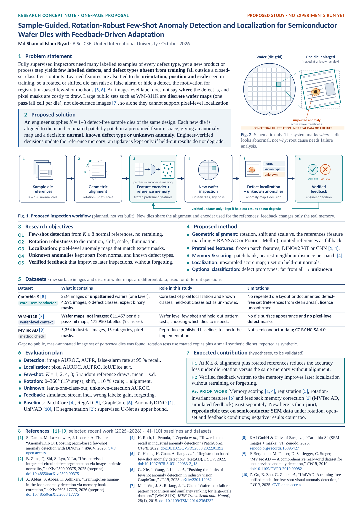

# Sample-Guided, Rotation-Robust Few-Shot Anomaly Detection and Localization for Semiconductor Wafer Dies

A one-page A4 research concept note for a university faculty member. It proposes a study; nothing has been built or run. Both figures are original schematics, not data or results.

| File | Use it for |
| --- | --- |
| `FewShot_Wafer_Die_Anomaly_Proposal.pdf` | The final one-page PDF. The figures are vector, the reference links are clickable, and all fonts are embedded as TrueType. |
| `proposal.html` | Editable source for the text and both figures (inline SVG). |
| `build.cjs` | Rebuilds the PDF and `preview.png`: `node research-proposal-fewshot/build.cjs` (needs `playwright`). It stops with an error if the page no longer fits on one A4 sheet. |

## Verification of references and dataset facts

Direct access to arXiv, Zenodo and IEEE DataPort was blocked in the build environment, so facts were checked through search results that quote the publisher, CVF, arXiv or Zenodo pages.

| Ref | Checked | Not confirmed |
| --- | --- | --- |
| [1] AnomalyDINO, WACV 2025 | Authors, title, venue, pages 1319–1329, CVF open-access page, arXiv 2405.14529 | IEEE Xplore DOI for the proceedings version (CVF link used instead) |
| [2] Zhao et al., arXiv:2509.09375 | Authors, title, affiliation (East China Normal University) | Exact posting date; peer-reviewed venue (cited as a preprint) |
| [3] Abbas et al., arXiv:2608.17775 | Authors, title; PatchCore memory-bank correction, 10 normal "golden" samples, MVTec AD, feedback simulated from ground truth | Peer-reviewed venue (cited as a preprint) |
| [4] PatchCore, CVPR 2022 | Title, venue, DOI | — |
| [5] RegAD, ECCV 2022 | Authors, title, full DOI 10.1007/978-3-031-20053-3_18 | — |
| [6] GraphCore, ICLR 2023 | Title, venue, arXiv 2301.12082, first three authors | Order of the last two authors differs between sources (shown as *et al.*) |
| [7] WM-811K, IEEE TSM 2015 | Authors, journal, volume, DOI; 811,457 maps, 172,950 labelled, 9 classes incl. "none" | Licence |
| [8] Carinthia-S, Zenodo 2025 | v1, published 20 Aug 2025; SEM images of one layer of unstructured (unpatterned) wafers; 4,591 images, 6 defect classes, expert-validated binary masks | Licence; individual author names (the record lists the institutions); image resolution; whether any defect-free images exist |
| [9] MVTec AD, CVPR 2019 | Authors, title, DOI | — |
| [10] UniVAD, CVPR 2025 | Authors, title, venue, pages 15194–15203 | IEEE Xplore DOI (CVF link used instead) |

MVTec AD's image count (5,354, 15 categories) and its CC BY-NC-SA 4.0 licence are from the dataset's published description and were not re-checked in this session.

Before sending the PDF, open every link once by hand.

## Integrity choices on the page

- **WM-811K** is described as discrete die-level wafer maps. The page says it has no die-surface images and no pixel-level defect masks.
- **Carinthia-S** is the core semiconductor image set. Its images show unpatterned wafers, so the page says there is no repeated die layout and no die-to-die reference.
- **No public patterned-die set** with pixel masks was found. The page says rotation tests will use rotated copies plus a synthetic die set, which will be reported as synthetic.
- **Contribution and novelty.** The contribution is stated as two hypotheses (H1, H2). The page names the prior work that already covers each component, including [3], which already tests feedback-based memory correction on MVTec AD.
- **Feedback.** Feedback-driven adaptation is described as something to test with a simulated verified stream that includes wrong labels.
- **Root cause.** The page says the system localizes where a die looks abnormal and does not determine physical root cause.
- **No invented content.** There are no results, accuracy figures or industry partners.
