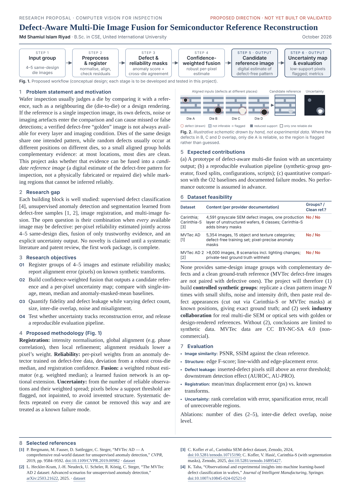

# Defect-Aware Multi-Die Image Fusion for Semiconductor Reference Reconstruction

A one-page (A4) research proposal written for a university faculty member. It describes a proposed direction only: the method has not been built or validated.

| File | Use it for |
| --- | --- |
| `Defect_Aware_MultiDie_Fusion_Proposal.pdf` | The final one-page PDF. All references are clickable links. |
| `proposal.html` | Editable source. Change the text in any editor, then rebuild. Both figures are inline SVG in this file. |
| `build.cjs` | Rebuilds the PDF and `preview.png`: `node research-proposal/build.cjs` (needs the `playwright` package). It stops with an error if the text no longer fits on one page. |

## References used

1. P. Bergmann, M. Fauser, D. Sattlegger, C. Steger, "MVTec AD — A comprehensive real-world dataset for unsupervised anomaly detection," CVPR 2019, pp. 9584–9592. <https://doi.org/10.1109/CVPR.2019.00982> · dataset: <https://www.mvtec.com/research-teaching/datasets/mvtec-ad>
2. L. Heckler-Kram, J.-H. Neudeck, U. Scheler, R. König, C. Steger, "The MVTec AD 2 dataset: Advanced scenarios for unsupervised anomaly detection," arXiv:2503.21622, 2025. <https://arxiv.org/abs/2503.21622> · dataset: <https://www.mvtec.com/research-teaching/datasets/mvtec-ad-2>
3. C. Kofler et al., Carinthia SEM defect dataset, Zenodo, 2024. <https://zenodo.org/records/10715190>; C. Kofler, V. Hasić, Carinthia-S (with segmentation masks), Zenodo, 2025. <https://zenodo.org/records/16895427>
4. K. Taha, "Observational and experimental insights into machine learning-based defect classification in wafers," Journal of Intelligent Manufacturing (Springer). <https://doi.org/10.1007/s10845-024-02521-0>

## What each reference supports

- [1], [2] Unsupervised anomaly detection and segmentation is an established field. These datasets give defect-free training images and pixel-level anomaly masks, but they contain no same-design groups and no paired clean references. MVTec data are CC BY-NC-SA 4.0 (non-commercial use only).
- [3] Real SEM defect appearance (4,591 grayscale images, one production layer of unstructured wafers, 6 classes). Carinthia-S adds binary masks (CC BY 4.0). Neither version has same-design multi-die groups or clean references.
- [4] Machine-learning wafer defect classification is well surveyed.

## Notes on accuracy

- Dataset facts come from the providers' pages and the paper abstracts. The figures in the PDF were not taken from any experiment.
- Fig. 2 is a hand-drawn schematic and is labelled as one.
- The proposal claims no novelty. It names a systematic literature and patent review as the first work package.
- The journal year for [4] is left out because it could not be confirmed from the publisher page.
